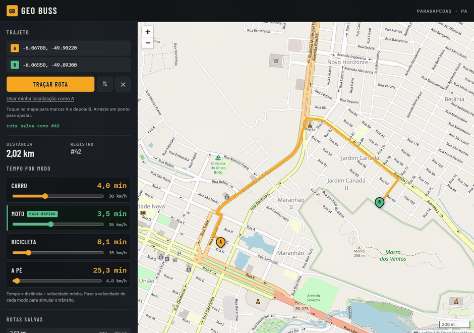

# Geo Buss

Rotas em Parauapebas/PA com tempo estimado para **carro, moto, bicicleta e a pé**.
Python puro (sem framework) + OSRM + PostgreSQL/PostGIS na VM Ubuntu.



*Mapa com pontos A/B, tempo por perfil (velocidade ajustável na hora) e rotas salvas.*

## Arquitetura

```
PC / VM
├── app.py            servidor HTTP (http.server) + static
├── rotas/rotas.py    ROTAS = {(método, caminho): função}
├── controles/        validação + orquestração (render/json_resposta)
├── servicos/
│   ├── osrm.py       cliente do osrm-backend (geometria + distância)
│   └── tempo.py      tempo por perfil: distância / velocidade
├── modelo/rota.py    persistência (PostGIS)
└── db/               conexão + schema.sql

VM Ubuntu
├── PostgreSQL 18 + PostGIS   histórico de rotas (GEOMETRY 4326 + GIST)
└── osrm-backend (Docker)     extrato OSM de Parauapebas, perfil car.lua
```

Fluxo: `POST /api/rota` → controller valida → OSRM devolve geometria/distância →
tempo é calculado para os 4 perfis → rota é gravada no PostGIS → JSON de resposta.

## Estrutura de pastas

```
geo buss/
├── app.py                  # servidor HTTP (http.server) + arquivos estáticos
├── config.py               # .env, perfis/velocidades e AREA_BBOX
├── rotas/rotas.py          # tabela (método, caminho) -> controller
├── controles/              # validação + respostas (home, rota, json)
├── servicos/               # cliente OSRM e cálculo de tempo
├── modelo/rota.py          # persistência no PostGIS
├── db/                     # conexão + schema.sql
├── templates/index.html    # interface (mapa Leaflet + painel)
├── static/css, static/js   # estilo e lógica do mapa
├── scripts/                # create_db, setup_osrm, deploy_app, verify_vm
├── deploy/                 # systemd, netplan e .env da VM
├── docs/                   # instalação, deploy e estado real da VM
├── requirements.txt / requirements-dev.txt
└── .env.example / .env.vm
```

> `.env` (local ou da VM) não vai para o git: use os modelos `.env.example`
> e `.env.vm` e troque a senha.

## API

| Método | Rota | Descrição |
|---|---|---|
| GET | `/` | mapa interativo |
| GET | `/api/perfis` | perfis e velocidades em uso |
| POST | `/api/rota` | calcula rota e devolve tempos por perfil |
| GET | `/api/rota?id=1` | rota salva (com geometria) |
| GET | `/api/historico?limite=20` | últimas rotas salvas |
| GET | `/api/status` | saúde do banco e do OSRM |

`POST /api/rota` aceita:

```json
{"origem": {"lat": -6.0678, "lon": -49.9022},
 "destino": {"lat": -6.0700, "lon": -49.8950}}
```

ou `{"origem": "-6.0678,-49.9022", "destino": "-6.0700,-49.8950"}` (ordem `lat,lon`).

Resposta (resumida):

```json
{
  "ok": true,
  "distancia_km": 3.42,
  "tempos": {
    "carro":     {"rotulo": "Carro",     "velocidade_kmh": 30.0, "tempo_min": 6.8},
    "moto":      {"rotulo": "Moto",      "velocidade_kmh": 35.0, "tempo_min": 5.9},
    "bicicleta": {"rotulo": "Bicicleta", "velocidade_kmh": 15.0, "tempo_min": 13.7},
    "pe":        {"rotulo": "A pé",      "velocidade_kmh": 4.8,  "tempo_min": 42.8}
  },
  "geometria": {"type": "LineString", "coordinates": [[-49.9022, -6.0678]]},
  "salvo": true,
  "id": 12
}
```

## Rodar local

```powershell
python -m venv .venv
.\.venv\Scripts\Activate.ps1
pip install -r requirements.txt
copy .env.example .env
python app.py
```

Acesse http://127.0.0.1:8000. Sem banco/OSRM a aplicação sobe, mas:
- `/api/rota` falha com 502 (OSRM fora);
- se o OSRM responder e o banco não, a rota é devolvida com `"aviso"` de não salva.

## VM Ubuntu (entrega)

Tudo roda na VM: app, frontend, PostGIS e OSRM. De fora, só o IP na porta 80.

- [`docs/DEPLOY_VM.md`](docs/DEPLOY_VM.md) — fluxo W11 → VM, rede bridged, checklist
- [`docs/INSTALACAO_VM.md`](docs/INSTALACAO_VM.md) — detalhes de Postgres/PostGIS/OSRM
- [`docs/AMBIENTE_VM.md`](docs/AMBIENTE_VM.md) — estado real da VM (IPs, serviços, operação)
- `scripts/create_db.sh`, `scripts/setup_osrm.sh`, `scripts/deploy_app.sh`, `scripts/verify_vm.sh`
- `deploy/geo-buss.service` — systemd, porta 80 sem root, `.env` em `.env.vm`

## Decisões

- **OSRM só geometria; tempo calculado na aplicação.** Velocidades configuráveis
  por perfil (`VEL_CARRO`, `VEL_MOTO`, `VEL_BICICLETA`, `VEL_PE`), sem depender de
  perfis de roteamento por veículo.
- **Área de atendimento fechada em Parauapebas** (`AREA_BBOX`, padrão
  `-50.05,-6.20,-49.75,-5.95`). Fora do recorte o OSRM encaixaria o ponto na
  borda da malha e devolveria uma rota falsa; agora a API responde 400.
- **Moto usa a malha viária do carro.** Bicicleta e a pé também; o que muda é a
  velocidade média. Geometria específica exigiria OSRM extra (`bicycle.lua`, `foot.lua`).
- **PostGIS guarda o histórico** (`GEOMETRY(Point/LineString, 4326)` + índices GIST),
  pronto para consultas espaciais (rotas por bairro, heatmap, isócronas).

## Licença

[MIT](LICENSE) © 2026 Melque Reis.
